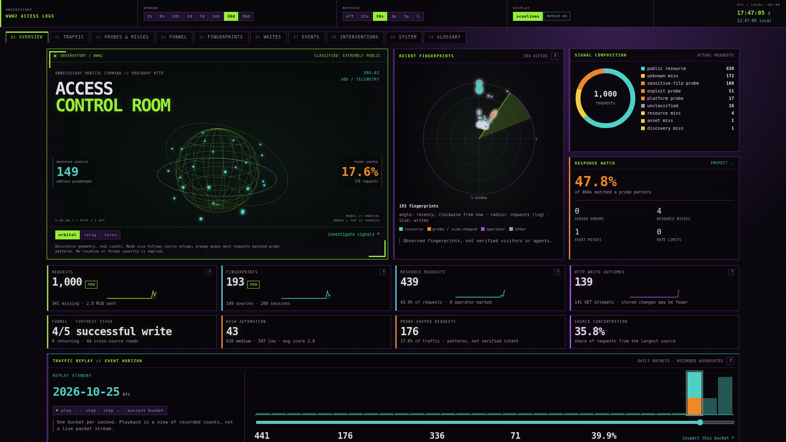
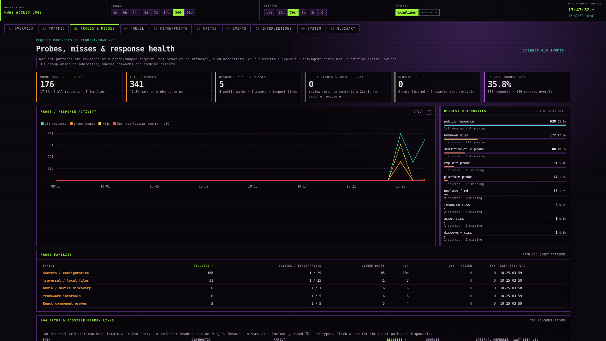

# Request diagnostics and command-room interface

Local verification on 2026-10-27. Deployment and hosted CI are separate checks.

The old scan count recognised a narrow set of paths, leaving many traversal,
framework, and nested configuration-file probes in “other.” The new diagnostic
report explains these patterns independently of historical research classes.
The Events query and export now honour the selected time window and the same
filters. The ledger list also follows the selected window. HTTP write outcomes
are labelled as an upper bound on stored changes.

## Interface

- Defaults: 30 days, 30-second refresh; one-time migration of existing browser
  settings, then persistence of new choices.
- Depth control and panel transforms removed. Motion follows the system's
  Reduce Motion setting, including changes while the page is open.
- UTC clock plus local time and its current UTC offset.
- Overview: rotating orbital/relay/torus wireframes, observed-source nodes,
  fingerprint radar, diagnostic composition and response watch.
- Traffic replay: select or play recorded UTC buckets, jump to the busiest
  bucket, and open its exact event interval. The first and last buckets are
  partial. Playback is disabled under Reduce Motion; manual stepping remains.
- Probes & misses: request categories, probe families, response timeline, 404
  paths and referrer counts, source concentration and user-agent churn, and
  reviewable 2xx probes, server errors, and resource/asset misses.
- Probe counts and filters in the traffic and fingerprint tables; diagnostic
  details in the event drawer; expandable tables and keyboard interactions.

## Verification

- Go regression/race suite and vet passed with Go 1.24.9. The Go suite also
  passed with Go 1.27.1, matching the hosted CI selection.
- Frontend TypeScript check and Vite production build passed.
- All 11 Python reference tests passed after replacing a stale fixed-date
  fixture with an event inside the test's 24-hour window.
- All ten top-level pages rendered at 1920px and 390px with no API error banner
  or page-level horizontal overflow. A mobile Events search-field overflow was
  found and repaired during this pass.
- Real browser checks exercised all three models, replay controls and interval
  drill-down, filters, drawer evidence, focus containment, Escape, and NDJSON
  download. Independent readback confirmed all 104 downloaded rows matched the
  selected sensitive-file diagnostic and 404 status.
- The model changed frames with motion enabled, remained static under Reduce
  Motion, and resumed when that preference was removed. Replay disabled itself
  under Reduce Motion. Existing display settings migrated to 30d/30s, ignored
  the obsolete motion-off preference, and did not restore the depth transform.
- Gitleaks found no leaks in the reviewed source inventory. Runtime state,
  pseudonym keys, populated environment, backups, ledgers, and QA fixtures stay
  excluded from source and Docker build contexts.

The browser fixture is a private copy of the latest 1,000 pseudonymous access
records, not the full production database. Screenshots illustrate that fixture;
their counts are not a current production report. No public relay writes were
made during verification.

## Deployment and rollback

The private observatory is a separate service from the public relay. Deployment
must preserve its SQLite database, pseudonym key, environment, log mounts,
ledger sync, private listener, and Authelia boundary. Take and independently
verify a database/key backup and retain the running image before cutover.

Startup backfills only four additive diagnostic columns from retained request
metadata. Regression checks verify that research classes, their reasons,
attribution and row counts survive backfill, including a second run. The new
indexes support diagnostic/time filters. API regression checks cover bearer
authentication, matching list/export filters, timestamp validation, inclusive
replay starts, and exclusive replay ends.

For application rollback, recreate only the observatory from its retained
image. Older binaries ignore the extra columns; retain the current database
and any later observations. Restoring an older database would discard those
observations and is a separate recovery action.

## Probe palette follow-up

The palette follow-up assigns fixed colors to each request diagnostic and each
of the eight probe families. Overview family bars, diagnostic composition,
Probes & misses bars and tables, and event-log family labels share the same
mapping in `frontend/src/lib/diagnostics.ts`. The glossary includes a live color
key at `/glossary#probe-colors`, with interpretation notes. Colors identify
patterns and do not rank severity or establish exploit success.

Local verification used the retained full-history QA database copy, rather than
the earlier 1,000-row fixture. Overview, Probes & misses, and Glossary fit 1920px,
390px, and 320px viewports without page overflow. The seven families present in
that copy rendered with distinct colors in both chart views; the glossary also
shows the injection-family color even when that family has no records. Selecting
the sensitive-file family opened its filtered event list. Browser console checks
reported no errors or warnings. All palette colors exceed 8:1 contrast against
`#100d17`; labels and counts remain visible alongside colors. TypeScript and the
Vite production build passed. The earlier screenshots above predate this palette.
